<div align="center">



# Orqanta-Voice
### Ultra-Fast Streaming Multilingual Text-to-Speech Engine for 11 Indic Languages & English

<a href="https://github.com/GANDHIKALASI/Orqanta-Voice/blob/main/LICENSE"></a>
  <a href="https://huggingface.co/buggandhi/Orqanta-Voice"></a>
  <a href="https://colab.research.google.com/github/GANDHIKALASI/Orqanta-Voice/blob/main/Orqanta_Voice_Colab.ipynb"></a>
  <a href="https://github.com/GANDHIKALASI/Orqanta-Voice"></a>
  
  
  
  
</div>

---

## ⚡ Executive Summary

**Orqanta-Voice** is an ultra-fast, production-grade streaming text-to-speech (TTS) engine purpose-built for **11 major Indic languages and Indian English**. 

Engineered with continuous-batching CUDA graphs, **Orqanta-Voice** achieves a state-of-the-art **~14 ms Time-to-First-Audio (TTFA)** at batch size 1 on an H100 and serves **224 concurrent streams** with 0 playback stalls. It pairs an autoregressive **Qwen3 (0.6B)** language backbone with a 24 kHz **Mimi neural audio codec**, a dedicated 8-layer **Depth Transformer**, and **ECAPA-TDNN** zero-shot speaker adaptation.

Whether you need conversational bots, interactive IVR systems, real-time voice assistants, or studio-grade narration, Orqanta-Voice provides natural human cadence, seamless zero-shot voice cloning (3–10s audio), and native text normalization for numbers, currency, and dates.

---

## 🎧 Audio Showcase & Multilingual Demos

Listen to real audio samples generated directly by Orqanta-Voice across different languages and voices:

| Language | Voice & Character | Sample Transcript | Audio Preview & Download |
| :--- | :--- | :--- | :---: |
| 🇬🇧 **English** | `Siddhant`<br>*(Adult Male, Professional)* | *"Welcome to the future of voice technology with Orqanta AI. Experience ultra-fast, real-time streaming speech across eleven Indic languages..."* | <audio controls src="assets/audio/promo_english.wav"></audio><br>[▶️ Download WAV](assets/audio/promo_english.wav) |
| 🇮🇳 **Odia (ଓଡ଼ିଆ)** | `Vaidehi`<br>*(Adult Female, Gentle)* | *"ଓରକାନ୍ତା ଏଆଇ ତରଫରୁ ଆପଣ ସମସ୍ତଙ୍କୁ ସ୍ୱାଗତ। ଆମର ନୂତନ ଓରକାନ୍ତା ଭଏସ୍ ଇଞ୍ଜିନ୍ ସହିତ ଏବେ ୧୧ଟି ଭାରତୀୟ ଭାଷାରେ ଅତି ସ୍ପଷ୍ଟ କଣ୍ଠସ୍ୱର ଉପଲବ୍ଧ..."* | <audio controls src="assets/audio/promo_odia.wav"></audio><br>[▶️ Download WAV](assets/audio/promo_odia.wav) |
| 🇮🇳 **Odia (ବାତ୍ୟା ସତର୍କତା)** | `Vaidehi`<br>*(Adult Female, News Alert)* | *"ବାତ୍ୟା ଅର୍ଣ୍ଣବ ଏବେ ଓଡ଼ିଶା ଉପକୂଳ ମୁହାଁ। ଆସନ୍ତା ୨୪ ଘଣ୍ଟା ମଧ୍ୟରେ ପବନର ବେଗ ୧୨୦ କିଲୋମିଟର ଏବଂ ରିଲିଫ୍ ପାଇଁ ₹୨୦୦ କୋଟି ଟଙ୍କା..."* | <audio controls src="assets/audio/output_odia.wav"></audio><br>[▶️ Download WAV](assets/audio/output_odia.wav) |
| 🇮🇳 **Hindi (हिन्दी)** | `Vaidehi`<br>*(Adult Female, Expressive)* | *"नमस्कार! ओरकांता एआई की दुनिया में आपका स्वागत है। प्रस्तुत है ओरकांता वॉइस, भारत का सबसे तेज़ और आधुनिक वॉइस एआई इंजन..."* | <audio controls src="assets/audio/promo_hindi.wav"></audio><br>[▶️ Download WAV](assets/audio/promo_hindi.wav) |
| 🇮🇳 **Telugu (తెలుగు)** | `Sreekar`<br>*(Adult Male, Conversational)* | *"నమస్కారం! ఓర్కాంటా ఏఐ కి స్వాగతం. భారతదేశపు అత్యుత్తమ రియల్-టైమ్ వాయిస్ టెక్నాలజీతో మీ ముందుకు వచ్చింది ఓర్కాంటా వాయిస్..."* | <audio controls src="assets/audio/promo_telugu.wav"></audio><br>[▶️ Download WAV](assets/audio/promo_telugu.wav) |
| 🇮🇳 **Tamil (தமிழ்)** | `Kayal`<br>*(Adult Female, Clear)* | *"வணக்கம்! ஓர்காண்டா ஏஐ உங்களை அன்புடன் வரவேற்கிறது. இந்தியாவின் அதிவேக ஸ்ட்ரீமிங் வாய்ஸ் தொழில்நுட்பம் ஓர்காண்டா வாய்ஸ்..."* | <audio controls src="assets/audio/promo_tamil.wav"></audio><br>[▶️ Download WAV](assets/audio/promo_tamil.wav) |
| 🇮🇳 **Bengali (বাংলা)** | `Anirban`<br>*(Adult Male, Steady Narrator)* | *"নমস্কার! ওরকান্তা এআই-এর জগতে আপনাকে স্বাগতম। উপস্থাপন করছি ওরকান্তা ভয়েস, ভারতের দ্রুততম মাল্টিলিঙ্গুয়াল স্পিচ ইঞ্জিন..."* | <audio controls src="assets/audio/promo_bengali.wav"></audio><br>[▶️ Download WAV](assets/audio/promo_bengali.wav) |
| 🇮🇳 **Gujarati (ગુજરાતી)** | `Vaidehi`<br>*(Adult Female, Calm)* | *"નમસ્તે! ઓરકાન્તા એઆઈ માં આપનું હાર્દિક સ્વાગત છે. ઓરકાન્તા વૉઇસ સાથે હવે ૧૧ ભારતીય ભાષાઓમાં મેળવો સૌથી ઝડપી અને કુદરતી અવાજ..."* | <audio controls src="assets/audio/promo_gujarati.wav"></audio><br>[▶️ Download WAV](assets/audio/promo_gujarati.wav) |
| 🇮🇳 **Punjabi (ਪੰਜਾਬੀ)** | `Nakul`<br>*(Young Male, Energetic)* | *"ਸਤਿ ਸ੍ਰੀ ਅਕਾਲ! ਓਰਕਾਂਤਾ ਏਆਈ ਵਿੱਚ ਤੁਹਾਡਾ ਨਿੱਘਾ ਸੁਆਗਤ ਹੈ। ਪੇਸ਼ ਹੈ ਓਰਕਾਂਤਾ ਵੌਇਸ, ਜੋ ਪੰਜਾਬੀ ਅਤੇ ਹੋਰ ਭਾਰਤੀ ਭਾਸ਼ਾਵਾਂ ਵਿੱਚ ਸੁਪਰ-ਫਾਸਟ ਆਵਾਜ਼ ਪੈਦਾ ਕਰਦਾ ਹੈ..."* | <audio controls src="assets/audio/promo_punjabi.wav"></audio><br>[▶️ Download WAV](assets/audio/promo_punjabi.wav) |
| 🇮🇳 **Marathi (मराठी)** | `Charvi`<br>*(Young Female, Upbeat)* | *"नमस्कार! ओरकांता एआय मध्ये आपले सहर्ष स्वागत आहे. सादर करत आहोत ओरकांता व्हॉईस, भारताचे प्रगत रिअल-टाईम ऑडिओ जनरेशन तंत्रज्ञान..."* | <audio controls src="assets/audio/promo_marathi.wav"></audio><br>[▶️ Download WAV](assets/audio/promo_marathi.wav) |
| 🇮🇳 **Kannada (ಕನ್ನಡ)** | `Nakul`<br>*(Young Male, Youthful)* | *"ನಮಸ್ಕಾರ! ಓರ್ಕಾಂತಾ ಎಐ ಗೆ ಸುಸ್ವಾಗತ. ಭಾರತದ ಅತ್ಯಂತ ವೇಗದ ಮತ್ತು ನೈಸರ್ಗಿಕ ಧ್ವನಿ ತಂತ್ರಜ್ಞಾನವಾದ ಓರ್ಕಾಂತಾ ವಾಯ್ಸ್ ಅನ್ನು ಅನುಭವಿಸಿ..."* | <audio controls src="assets/audio/promo_kannada.wav"></audio><br>[▶️ Download WAV](assets/audio/promo_kannada.wav) |

---

## 🌟 Key Highlights

* **12 Languages Supported:** English (`en`), Odia (`or`), Hindi (`hi`), Telugu (`te`), Tamil (`ta`), Bengali (`bn`), Marathi (`mr`), Gujarati (`gu`), Kannada (`kn`), Malayalam (`ml`), Punjabi (`pa`), and Assamese (`as`).
* **Ultra-Low Latency:** ~14 ms TTFA on H100 GPU; <90 ms on T4 GPU in Google Colab.
* **Continuous-Batching CUDA Graphs:** Zero CPU overhead during generation loops. One GPU dynamically serves dozens to hundreds of concurrent WebSocket callers.
* **Studio-Quality 24 kHz Sound:** 8-codebook neural acoustic compression powered by Kyutai's Mimi architecture.
* **Instant Zero-Shot Voice Cloning:** Clone any voice with 3–10 seconds of reference speech.
* **Intelligent Indic Text Normalization (TN):** Automatically turns digits (`୨୪` ➔ `ଚବିଶି`), currencies (`₹୫୦୦` ➔ `પાંચસો રૂપિયા`), dates, abbreviations, and percentages into spoken words.
* **Production-Ready Servers:** Includes built-in OpenAI-compatible HTTP `/v1/audio/speech` endpoint and low-latency WebSocket bidirectional streaming server.

---

## 🗣️ Supported Languages & Built-in Voices

Orqanta-Voice ships with **20 built-in named voices** across diverse genders, tones, and ages:

| Voice Name | Gender | Age / Style | Supported Languages |
| :--- | :--- | :--- | :--- |
| **`Siddhant`** | Male | Adult, Clear, Professional | Multilingual (`en`, `hi`, `or`, `te`, `ta`, `bn`, `mr`, `gu`, `kn`, `ml`, `pa`, `as`) |
| **`Vaidehi`** | Female | Adult, Calm, Gentle | Multilingual (`en`, `hi`, `or`, `te`, `ta`, `bn`, `mr`, `gu`, `kn`, `ml`, `pa`, `as`) |
| **`Ahana`** | Female | Young, Bright, Youthful | Multilingual (`en`, `hi`, `or`, `te`, `ta`, `bn`, `mr`, `gu`, `kn`, `ml`, `pa`, `as`) |
| **`Anirban`** | Male | Adult, Steady Narrator | Multilingual (`en`, `hi`, `or`, `te`, `ta`, `bn`, `mr`, `gu`, `kn`, `ml`, `pa`, `as`) |
| **`Malini`** | Female | Mature, Steady Narrator | Multilingual (`en`, `hi`, `or`, `te`, `ta`, `bn`, `mr`, `gu`, `kn`, `ml`, `pa`, `as`) |
| **`Nakul`** | Male | Young, Energetic, Upbeat | Multilingual (`en`, `hi`, `or`, `te`, `ta`, `bn`, `mr`, `gu`, `kn`, `ml`, `pa`, `as`) |
| **`Charvi`** | Female | Young, Upbeat, Dynamic | Multilingual (`en`, `hi`, `or`, `te`, `ta`, `bn`, `mr`, `gu`, `kn`, `ml`, `pa`, `as`) |
| **`Satvik`** | Male | Young, Warm, Friendly | Multilingual (`en`, `hi`, `or`, `te`, `ta`, `bn`, `mr`, `gu`, `kn`, `ml`, `pa`, `as`) |
| **`Jahnavi`** | Female | Adult, Warm, Friendly | Multilingual (`en`, `hi`, `or`, `te`, `ta`, `bn`, `mr`, `gu`, `kn`, `ml`) |
| **`Vasant`** | Male | Mature, Authoritative | Multilingual (`en`, `hi`, `or`, `te`, `ta`, `bn`, `mr`, `gu`, `kn`, `ml`) |
| **`Sreekar`** | Male | Adult, Natural Conversational | Native Telugu & English/Hindi (`te`, `en`, `hi`) |
| **`Kayal`** | Female | Adult, Natural Conversational | Native Tamil & English (`ta`, `en`) |
| **`Abhay`** | Male | Adult, Casual Conversational | Native Hindi & English (`hi`, `en`) |
| **`Nivedita`** | Female | Adult, Professional News | Native Hindi & English (`hi`, `en`) |
| **`Ishwari`** | Female | Adult, Expressive | Native Hindi (`hi`) |
| **`Ritvik`** | Male | Adult, Deep Baritone | Native Hindi (`hi`) |
| **`Vrinda`** | Female | Young, Gentle | Native Hindi (`hi`) |
| **`Shaunak`** | Male | Young, Conversational | Native Hindi & English (`hi`, `en`) |
| **`Akshat`** | Male | Adult, Dynamic Storyteller | Native Hindi & English (`hi`, `en`) |
| **`Tanushree`** | Female | Adult, Warm Conversational | Native Hindi & English (`hi`, `en`) |

---

## 🚀 Quickstart

### 1. One-Click Google Colab (Recommended)
You can run Orqanta-Voice for free on a Google Colab T4 GPU:

[](https://colab.research.google.com/github/GANDHIKALASI/Orqanta-Voice/blob/main/Orqanta_Voice_Colab.ipynb)

```bash
!git clone https://github.com/GANDHIKALASI/Orqanta-Voice.git
%cd Orqanta-Voice
!pip uninstall -y torchvision
!pip install -e .
!pip install soundfile
```

---

### 2. Python API Usage

```python
import soundfile as sf
from orqanta_voice import OrqantaVoiceTTS

# Initialize engine on CUDA with 1 generation seat
tts = OrqantaVoiceTTS.from_pretrained(device="cuda", max_seats=1)

# Synthesize speech (Text Normalization enabled by default for numbers and currency)
text = "ଆସନ୍ତା ୨୪ ଘଣ୍ଟା ମଧ୍ୟରେ ପବନର ବେଗ ୧୨୦ କିଲୋମିଟର ହେବାର ସମ୍ଭାବନା ଅଛି।"
waveform = tts.generate(text, lang="or", voice="Vaidehi")

# Save 24 kHz audio
sf.write("output.wav", waveform, 24000)
```

---

### 3. Zero-Shot Voice Cloning

Clone any custom voice in real-time from just **3 to 10 seconds** of reference audio:

```python
# 1. Register a custom voice
tts.register_voice(
    name="my_voice",
    ref_audio="my_reference_sample.wav",      # Path to clear audio
    ref_text="The exact words spoken in the audio clip",
    lang="en"
)

# 2. Synthesize using the cloned voice across any language
cloned_wav = tts.generate(
    "Hello! Now I am speaking in your cloned voice with high accuracy.",
    lang="en",
    voice="my_voice"
)
sf.write("cloned_output.wav", cloned_wav, 24000)
```

---

### 4. High-Performance WebSocket Streaming Server

For ultra-low-latency real-time voice bots (audio streaming chunks as they are generated):

```bash
# Start the streaming server
python -m orqanta_voice.server --host 0.0.0.0 --port 8000 --seats 8
```

Stream in Python using the async client:

```python
import asyncio
from orqanta_voice.client import AsyncOrqantaVoiceClient

async def main():
    client = AsyncOrqantaVoiceClient("ws://localhost:8000/v1/stream")
    async for chunk in client.stream_speech("Streaming speech token by token in real time.", lang="en", voice="Siddhant"):
        # Play or forward raw 24 kHz PCM chunk immediately
        pass

asyncio.run(main())
```

---

### 5. OpenAI-Compatible HTTP Server

Integrate Orqanta-Voice directly into any OpenAI TTS client or frontend:

```python
from openai import OpenAI

client = OpenAI(base_url="http://localhost:8000/v1", api_key="none")

response = client.audio.speech.create(
    model="orqanta-voice",
    voice="Vaidehi",
    input="नमस्ते! ओरकांता वॉइस में आपका स्वागत है।"
)
response.stream_to_file("hindi_output.mp3")
```

---

## 📊 Technical Architecture & Benchmarks

```
                       ┌───────────────────────────────────────┐
                       │   Text Input (11 Indic + English)     │
                       └──────────────────┬────────────────────┘
                                          │ Text Normalization (TN)
                                          ▼
                       ┌───────────────────────────────────────┐
                       │  Qwen3 (0.6B) Language Backbone       │
                       │  - Autoregressive Codebook 0 tokens   │
                       │  - Continuous-Batching CUDA Graphs   │
                       └──────────────────┬────────────────────┘
                                          │
                                          ▼
                       ┌───────────────────────────────────────┐
                       │  8-Layer Depth Transformer            │
                       │  - Parallel Codebooks 1-7 Prediction  │
                       │  - Speaker Anchor (192-dim ECAPA)     │
                       └──────────────────┬────────────────────┘
                                          │
                                          ▼
                       ┌───────────────────────────────────────┐
                       │  Mimi Neural Audio Codec (24 kHz)     │
                       │  - Continuous Frame Upsampling        │
                       │  - Hi-Fi 24 kHz Output Waveform       │
                       └───────────────────────────────────────┘
```

* **TTFA (Time-to-First-Audio):** ~14 ms (H100, B=1)
* **Concurrent Throughput:** 224 simultaneous streams at 323 seconds of audio per real-time second.
* **P99 Latency:** 242 ms under maximum steady-state load with **0 playback stalls**.
* **Memory Footprint:** 3.8 GB GPU VRAM (FP16/BF16 weights and KV caches).

---

## 🏷️ Model Metadata & Specifications

| Property | Details |
| :--- | :--- |
| **Model Type** | Streaming Autoregressive Neural Text-to-Speech (TTS) |
| **License** | [Apache-2.0](LICENSE) |
| **Supported Languages** | English (`en`), Odia (`or`), Hindi (`hi`), Telugu (`te`), Tamil (`ta`), Bengali (`bn`), Marathi (`mr`), Gujarati (`gu`), Kannada (`kn`), Malayalam (`ml`), Punjabi (`pa`), Assamese (`as`) |
| **Acoustic Backbone** | Qwen3 (0.6B) + 8-Layer Depth Transformer |
| **Audio Codec** | Kyutai Mimi Neural Codec (8 codebooks @ 12.5 Hz framerate) |
| **Sample Rate** | 24,000 Hz (24 kHz) Hi-Fi Waveform |
| **Speaker Embeddings** | ECAPA-TDNN (192-dimensional continuous speaker anchor) |
| **Latency Benchmark** | ~14 ms TTFA (H100) / <90 ms TTFA (Colab T4 GPU) |
| **Tags** | `text-to-speech`, `tts`, `audio`, `speech`, `indic`, `streaming`, `voice-cloning`, `zero-shot` |

---

## 👨‍💻 Developer & Maintainer

<table align="center" style="border-collapse: collapse; border: none;">
  <tr>
    <td align="center" width="160">
      <a href="https://github.com/GANDHIKALASI">
        
      </a>
    </td>
    <td style="padding-left: 20px;">
      <h3 style="margin: 0; color: #00f2fe;">Gandhi Kalasi</h3>
      <p style="margin: 4px 0 10px 0; font-size: 14px; color: #94a3b8;">
      
<p>
  <b>AI Product Engineer Aspirant</b> | Creator &amp; Maintainer of <i>Orqanta AI</i> &amp; <i>Orqanta Voice</i>
</p>
<p style="margin: 0 0 12px 0; font-size: 13.5px; line-height: 1.5;">
  Passionate about building AI-powered products, exploring large language models (LLMs) and AI agents, and developing practical software solutions that turn complex ideas into useful, real-world applications.
</p>
      </p>
      <div>
        <a href="https://github.com/GANDHIKALASI">
          
        </a>
        &nbsp;
        <a href="https://instagram.com/bug_gandhi">
          
        </a>
        &nbsp;
        <a href="https://huggingface.co/buggandhi/Orqanta-Voice">
          
        </a>
        &nbsp;
        <a href="https://github.com/GANDHIKALASI/Orqanta-Voice">
          
        </a>
        &nbsp;
        <a href="https://github.com/GANDHIKALASI/Orqanta-Voice/issues">
          
        </a>
      </div>
    </td>
  </tr>
</table>

---

## 📄 License

Orqanta-Voice is licensed under the **[Apache License 2.0](LICENSE)**.
